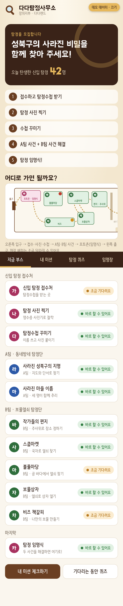
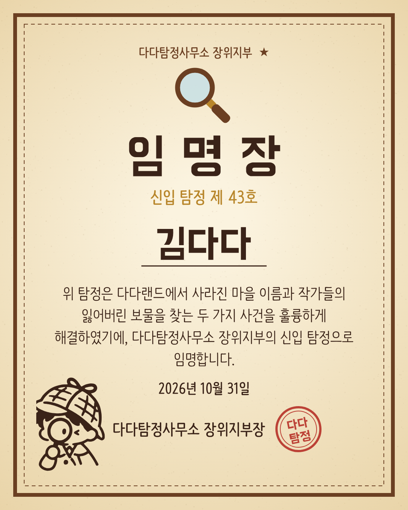
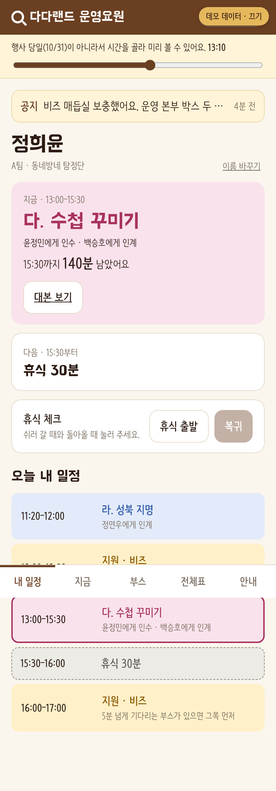
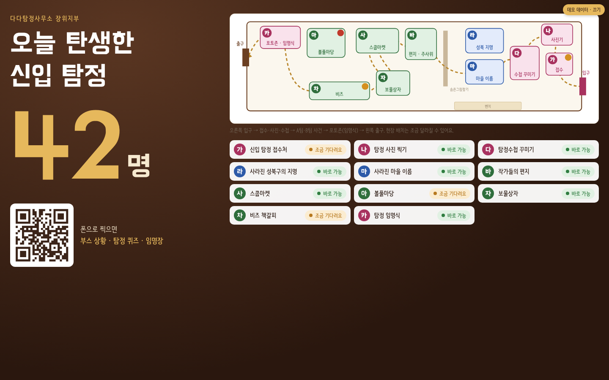
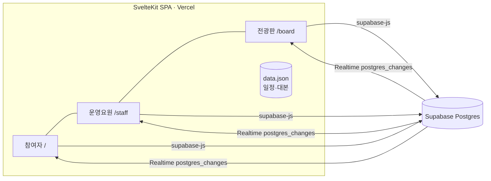
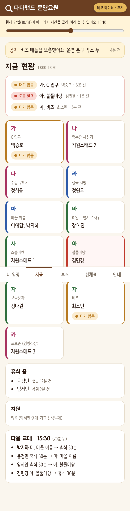
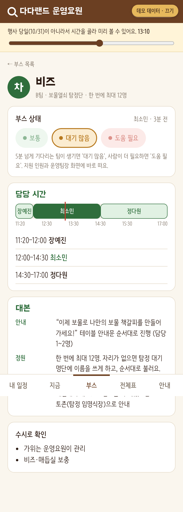
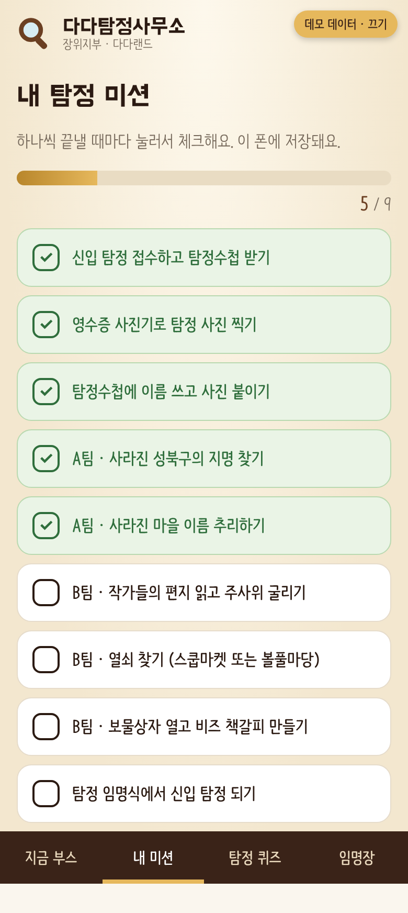
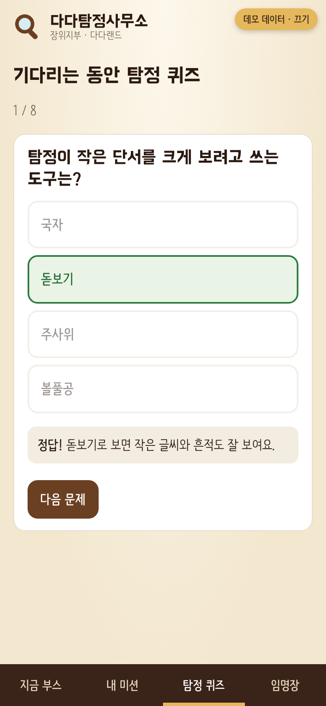

# 다다랜드 · 다다탐정사무소 장위지부

성북구 동네 축제 **다다페스타**의 체험 공간 *다다랜드*를 위해 만든 웹앱이에요. 아이들은 신입 탐정이 되어 A팀(사라진 마을 이름)과 B팀(작가들의 잃어버린 보물) 두 사건을 해결하고, 운영요원 15명은 11개 부스를 교대로 맡아요. 하루짜리 현장 행사에서 **참여자 경험**과 **운영 흐름**을 같은 데이터로 묶는 것을 목표로 했어요.

<p align="center">
  
  
  
</p>

## 두 개의 얼굴

| | 참여자 (`/`) | 운영요원 (`/staff`) |
|---|---|---|
| 들어오는 길 | 부스 안내판 QR | 운영요원 명찰 뒤 카드 QR |
| 핵심 질문 | “어디부터 갈까? 얼마나 기다려?” | “지금 어디 있어야 하고, 언제 누구와 교대하지?” |
| 화면 | 지금 부스(혼잡도·배치도), 내 미션, 탐정 퀴즈, 임명장 | 내 일정, 지금 현황, 부스(대본·상태), 전체표, 안내(공지) |

그리고 **`/board`** — 현장 모니터용 전광판. 오늘 탄생한 신입 탐정 수가 실시간으로 올라가고, 새 탐정이 나오면 “방금 제 N호 탐정 탄생!”이 떠요.

<p align="center"></p>

## 기능

**참여자**
- **실시간 혼잡도** — 운영요원이 부스에서 누른 상태(보통 / 대기 많음 / 도움 필요)가 참여자에게는 “바로 할 수 있어요 / 조금 기다려요”로 보여요. 보호자가 덜 붐비는 팀을 골라 가면서 대기가 자연스럽게 분산돼요.
- **공간 배치도** — 피그마 배치 초안을 SVG로 다시 그렸어요. 현장 치수가 바뀌어도 동선은 같아서 좌표만 고치면 돼요. 부스 상태가 점으로 겹쳐 보여요.
- **내 미션** — 접수부터 임명식까지 9단계 체크리스트 (기기 저장).
- **탐정 퀴즈** — 대기 시간용 8문항. 게임 정답은 스포일러가 되지 않게 뺐어요.
- **신입 탐정 임명장** — 이름을 넣으면 Canvas로 1080×1350 임명장을 그려 저장·공유해요. 번호는 서버에서 발급되지만 **이름은 서버로 보내지 않아요.** 탐정수첩 일러스트를 potrace로 벡터화해 `Path2D`로 그려서 어떤 해상도에서도 선명해요.

**운영요원**
- **내 일정** — 이름을 한 번 고르면 지금 맡은 부스, 남은 시간, 다음 일정, 인수·인계 상대(누구에게 받고 누구에게 넘기는지)를 계산해서 보여줘요.
- **지금 현황** — 11개 부스 현재 담당자, 휴식·지원 인원, 다음 교대까지 남은 시간과 이동 목록. 문제가 생긴 부스는 맨 위로.
- **부스** — 담당 시간 막대(현재 시각 선), 부스별 대본, 수시 확인 사항, 상태 버튼.
- **휴식 체크·공지** — 휴식 출발/복귀, 운영팀장 공지가 모두에게 실시간 반영.
- **미리보기 시간** — 행사 당일이 아니면 슬라이더로 시간을 골라 리허설할 수 있어요.

## 구조



- **정적 데이터와 실시간 데이터의 분리** — 일정·대본처럼 행사 전에 확정되는 건 `src/lib/data.json` 하나에 두고 빌드에 포함해요. 서버에는 바뀌는 것만(부스 상태, 휴식, 공지, 탐정 번호) 둬요. 네트워크가 불안정한 현장에서도 일정 화면은 항상 떠요.
- **우아한 저하** — Supabase 환경변수가 없거나 연결이 끊기면 실시간 UI만 숨고 나머지는 그대로 동작해요.
- **교대 계산** — 사람별 30분 칸(`slots`)만 저장하고, 부스별 담당 구간·인수인계 상대·다음 교대는 모두 계산으로 만들어요. 일정 하나를 고치면 운영요원 화면, 부스 화면, 전체표가 함께 바뀌어요.
- **데모 모드** — `?demo`를 붙이면 서버 없이 예시 데이터로 모든 실시간 화면이 움직여요(리허설·포트폴리오용).

| 테이블 | 용도 | 개인정보 |
|---|---|---|
| `booth_status` | 부스별 상태 | 운영요원 이름(표시용) |
| `breaks` | 휴식 출발/복귀 | 운영요원 이름 |
| `notices` | 운영 공지 | 작성자 이름 |
| `detectives` | 임명장 번호 발급 | 없음 (번호·시각만) |

## 기술

SvelteKit 2 · Svelte 5 runes · TypeScript · Supabase (Postgres, RLS, Realtime) · Vercel · Canvas 2D · SVG

## 실행

```bash
npm install
cp .env.example .env   # 실시간 기능을 쓰려면 Supabase 값 입력
npm run dev            # http://localhost:5173/?demo 로 데모 데이터 확인
```

## 배포

1. Supabase 새 프로젝트 → SQL Editor에서 `supabase/schema.sql` 실행
2. Vercel에서 이 저장소 Import (SvelteKit 자동 인식)
3. Vercel 환경변수 `PUBLIC_SUPABASE_URL`, `PUBLIC_SUPABASE_ANON_KEY` 입력 후 재배포

일정을 바꾸려면 `src/lib/data.json`의 `people[].slots`(11칸: 11:20, 12:00 … 16:30, 값은 부스 글자 가~카 · `휴` · `지` · `-`)를 고치면 돼요. 배치도 좌표는 `src/lib/components/FloorPlan.svelte`에 있어요.

## 행사 후

로그인 없이 쓰도록 열어 둔 쓰기 권한은 `supabase/schema.sql` 맨 아래 '정리' 부분으로 닫아요.

## 더 보기

<p>
  
  
  
  
</p>
